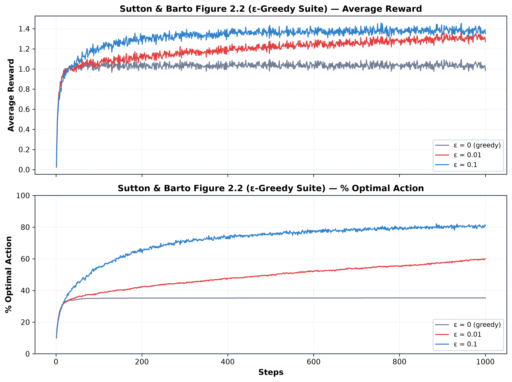
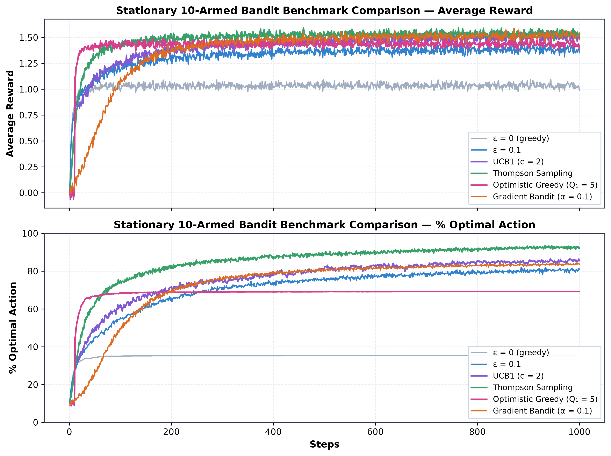
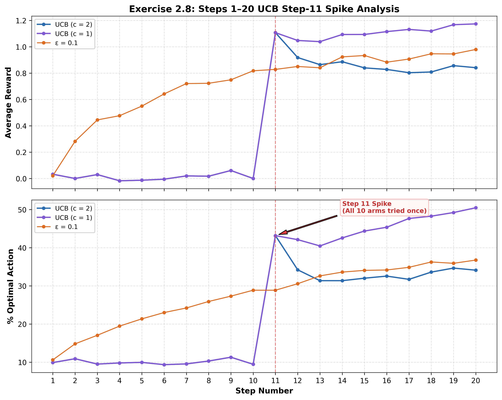
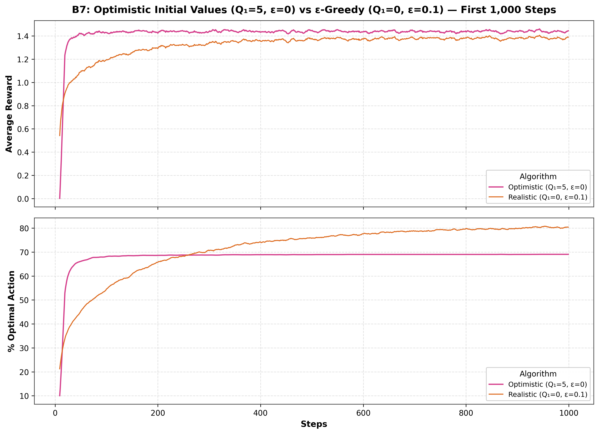
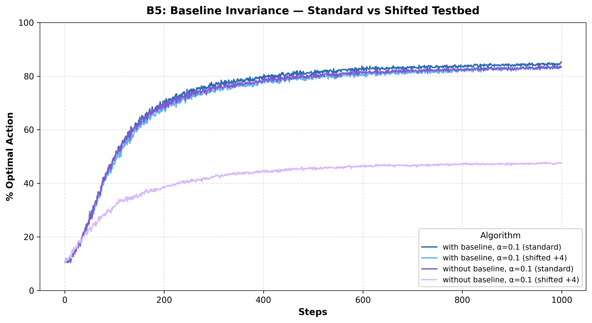
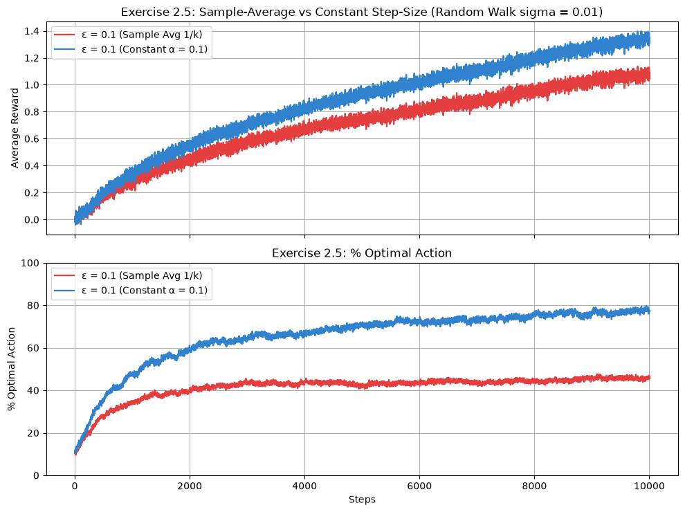
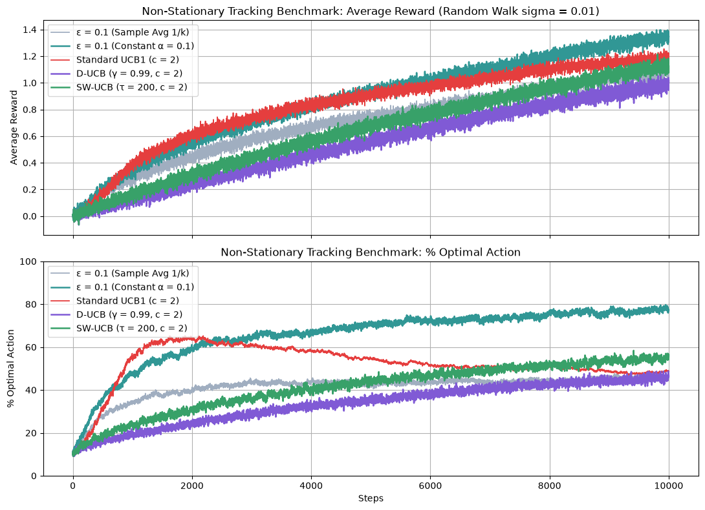

# Multi-Armed Bandits: Sutton & Barto Chapter 2 Study

Implementations, experiments, and empirical notes based on Chapter 2 of *Reinforcement Learning: An Introduction* (Sutton and Barto, 2018), along with non-stationary tracking extensions.

---

## Overview

The multi-armed bandit problem is a simplified reinforcement learning setting with a single state. The agent repeatedly selects one of $K$ actions and receives a numerical reward from a stationary or drifting probability distribution. The goal is to maximize cumulative reward over time by balancing exploration (trying unfamiliar arms) and exploitation (pulling known good arms).

This repository contains:
* The 10-armed Gaussian testbed from Section 2.2.
* Epsilon-greedy action selection with sample-average updates (Section 2.3, Figure 2.2).
* Upper Confidence Bound (UCB1) action selection and the step 11 spike (Section 2.7, Figure 2.4, Exercise 2.8).
* Optimistic initial values for driving early exploration (Section 2.6).
* Gradient bandits with and without baseline under reward shifts (Section 2.8, Figure 2.5).
* Non-stationary random walk tracking with constant step size alpha (Exercise 2.5).
* Discounted UCB (D-UCB) and Sliding-Window UCB (SW-UCB) for tracking moving targets.
* Gaussian Thompson Sampling (Bayesian posterior matching with conjugate Gaussian prior).

All simulations run over 2,000 independent bandit problems in parallel using NumPy arrays.

---

## List of Figures

| Figure | Description | Generating Script | Textbook Reference |
| :---: | :--- | :--- | :--- |
| **Figure 1** | Epsilon-Greedy on 10-Armed Testbed | `experiments/run_stationary.py` | Section 2.3, Figure 2.2 |
| **Figure 2** | Stationary Comparison Across Methods | `experiments/run_stationary.py` | Chapter 2 Summary |
| **Figure 3** | UCB1 Step 11 Spike Inspection | `experiments/run_stationary.py` | Section 2.7, Exercise 2.8 |
| **Figure 4** | Optimistic Initial Values ($Q_1 = 5$) | `experiments/run_stationary.py` | Section 2.6 |
| **Figure 5** | Gradient Bandit Baseline Invariance (+4 Shift) | `experiments/run_stationary.py` | Section 2.8, Figure 2.5 |
| **Figure 6** | Exercise 2.5: Sample-Avg vs Constant Step-Size | `experiments/run_nonstationary.py` | Exercise 2.5 |
| **Figure 7** | Full Non-Stationary Multi-Method Tracking | `experiments/run_nonstationary.py` | Modern Extension |

---

## Algorithm Summary

| Algorithm | Action Selection Strategy | Update Rule | Suitable for Non-Stationary? |
| :--- | :--- | :--- | :---: |
| **Epsilon-Greedy (Sample-Avg)** | Random action with probability $\epsilon$, else $\arg\max Q$ | $Q_{k+1} = Q_k + \frac{1}{k}(R_k - Q_k)$ | No ($1/k \to 0$) |
| **Epsilon-Greedy (Constant $\alpha$)** | Random action with probability $\epsilon$, else $\arg\max Q$ | $Q_{k+1} = Q_k + \alpha(R_k - Q_k)$ | Yes (exponential recency) |
| **Optimistic Greedy** | Greedy ($\epsilon = 0$) with high initial estimates ($Q_1 = +5$) | $Q_{k+1} = Q_k + \frac{1}{k}(R_k - Q_k)$ | No (temporary exploration) |
| **UCB1** | Select $\arg\max [Q(a) + c \sqrt{\ln t / N(a)}]$ | $Q_{k+1} = Q_k + \frac{1}{k}(R_k - Q_k)$ | No (uncertainty bonus shrinks) |
| **Discounted UCB (D-UCB)** | UCB with geometrically discounted counts and rewards ($\gamma = 0.99$) | $N \leftarrow \gamma N + 1$, $W \leftarrow \gamma W + R$ | Yes (tracks drift) |
| **Sliding-Window UCB (SW-UCB)** | UCB over the most recent $\tau = 200$ observations | FIFO buffer of length $\tau$ | Yes (tracks drift) |
| **Gradient Bandit** | Softmax policy over action preferences $H(a)$ | $H_{k+1} = H_k + \alpha(R - \bar{R})(I - \pi)$ | Yes (constant step size) |
| **Thompson Sampling** | Sample $\theta_a \sim \mathcal{N}(\mu_{post}, \sigma^2_{post})$, pick $\arg\max \theta$ | Conjugate Gaussian posterior update | Needs discounting |

---

## Experiments and Empirical Findings

### 1. Epsilon-Greedy Testbed (Figure 2.2 Reproduction)

As shown in **Figure 1** below, this experiment evaluates 2,000 independent 10-armed bandit tasks over 1,000 steps. True arm values are drawn from $\mathcal{N}(0, 1)$, and rewards are drawn from $\mathcal{N}(q_*(a), 1)$.

[](figures/stationary_figure_2_2.png)
*Figure 1: Performance of epsilon-greedy action selection on the 10-armed testbed (2,000 runs, 1,000 steps). Top panel shows Average Reward; bottom panel shows % Optimal Action. Generated by experiments/run_stationary.py. Corresponds to Sutton & Barto Figure 2.2.*

Observations from Figure 1:
* **Pure Greedy ($\epsilon = 0$)**: Quickly plateaus at an average reward around 1.03 and only picks the optimal action about 35% of the time. Because it never explores deliberately, it gets stuck on whichever arm happens to return a positive reward first.
* **$\epsilon = 0.1$**: Explores 10% of the time. It discovers the best arm quickly, reaching about 80% optimal action selection by step 400. However, because it keeps exploring at a fixed 10% rate, it pays a permanent exploration tax and can never exceed 91% optimal action selection.
* **$\epsilon = 0.01$**: Explores slowly but steadily. It takes longer to locate the best arm, but by step 1,000 it is improving at a steeper rate and eventually overtakes $\epsilon = 0.1$ over long horizons because its ongoing exploration tax is only 1%.

---

### 2. Stationary Algorithm Comparison

In **Figure 2**, we compare all core Chapter 2 method families on the exact same 2,000 stationary bandit tasks:

[](figures/stationary_benchmark.png)
*Figure 2: Comparison across epsilon-greedy, UCB1, Gaussian Thompson Sampling, Optimistic Greedy, and Gradient Bandit algorithms (2,000 runs, 1,000 steps). Generated by experiments/run_stationary.py.*

Empirical metrics from the simulation curves plotted in Figure 2:

| Algorithm | Step 100 Reward | Step 1,000 Reward | Step 1,000 % Optimal Action | Notes |
| :--- | :---: | :---: | :---: | :--- |
| $\epsilon = 0$ (Greedy) | 1.01 | 1.03 | 35.30% | Severe suboptimality due to lack of exploration |
| $\epsilon = 0.1$ | 1.19 | 1.38 | 80.39% | Solid baseline, capped by 10% exploration tax |
| UCB1 ($c = 2$) | 1.25 | 1.51 | 85.28% | Outperforms $\epsilon$-greedy; uncertainty bonus decays naturally |
| Thompson Sampling | 1.42 | 1.54 | 92.54% | Highest performance; posterior sampling balances risk effectively |
| Optimistic Greedy ($Q_1 = 5$) | 1.41 | 1.44 | 69.20% | High early reward; exploration stops once optimism drains |
| Gradient Bandit ($\alpha = 0.1$) | 1.04 | 1.52 | 83.53% | Smooth policy convergence with running reward baseline |

---

### 3. UCB Action Selection and the Step 11 Spike (Exercise 2.8)

In UCB1, actions are selected by:

$$A_t = \arg\max_a \left[ Q_t(a) + c \sqrt{\frac{\ln t}{N_t(a)}} \right]$$

When an arm has not yet been pulled ($N_t(a) = 0$), the uncertainty term is considered infinite, forcing each of the 10 arms to be tried once during steps 1 through 10.

Referring to **Figure 3**, zooming in on the first 20 steps reveals the mechanics behind Exercise 2.8:

[](figures/ucb_step11_spike.png)
*Figure 3: Zoomed inspection of % Optimal Action across steps 1 to 20 for UCB1 (c=1, c=2) vs epsilon-greedy (eps=0.1). Note the spike at step 11. Generated by run_experiments.py (B4) and archived in figures/ucb_step11_spike.png. Corresponds to Sutton & Barto Exercise 2.8.*

Why the spike occurs in Figure 3:
* **Steps 1 to 10**: Every arm is pulled exactly once because unpulled arms have infinite upper confidence bounds. Since all arms are tested equally, optimal action selection stays around 10%.
* **Step 11 (The Spike)**: At step 11, every arm has $N(a) = 1$. The exploration bonus $c \sqrt{\ln(11) / 1}$ is identical for all 10 arms. Because the bonus is equal across all arms, the $\arg\max$ decision is determined entirely by $Q(a)$. UCB therefore acts as a pure greedy selector based on one observed reward per arm, driving the % optimal action metric above 40%.
* **Step 12**: The arm pulled at step 11 now has $N(a) = 2$, which lowers its exploration bonus and prompts the agent to try other arms again. The curve dips temporarily before resuming a steady climb.
* **Steps 100 to 1,000**: As visible in Figure 2, UCB surpasses $\epsilon$-greedy around step 100 and reaches 85.28% optimal action by step 1,000 because its exploration naturally tapers off for well-sampled arms.

---

### 4. Optimistic Initial Values (Section 2.6)

Setting initial action values to an optimistic level ($Q_1(a) = +5.0$) drives early exploration in a purely greedy agent ($\epsilon = 0$). As plotted in **Figure 4**:

[](figures/optimistic_initialization.png)
*Figure 4: Optimistic greedy agent (Q1=5, eps=0) compared against realistic epsilon-greedy (Q1=0, eps=0.1) over 1,000 steps. Generated by run_experiments.py (B7) and saved in figures/optimistic_initialization.png. Corresponds to Sutton & Barto Section 2.6.*

Observations from Figure 4:
* Because actual rewards are distributed around mean 0 with standard deviation 1, observed rewards are almost always lower than +5.
* Each time an arm is pulled, its estimated value drops, making other untried arms look relatively better.
* This forces the agent to try every arm multiple times early on.
* During the first 20 steps, optimistic greedy exhibits high variance and lower reward while it tests all arms. Around step 100 to 200, it settles down and reaches strong performance without paying an ongoing exploration tax.

---

### 5. Gradient Bandit and Baseline Invariance (Section 2.8, Figure 2.5)

The Gradient Bandit updates action preferences $H_t(a)$ using a softmax policy $\pi_t(a)$:

$$H_{t+1}(a) = H_t(a) + \alpha (R_t - \bar{R}_t) \left( \mathbb{I}_{a = A_t} - \pi_t(a) \right)$$

where $\bar{R}_t$ is the average of all rewards received up to time $t$.

**Figure 5** demonstrates the effect of adding a $+4$ constant shift to all rewards:

[](figures/gradient_baseline_shift.png)
*Figure 5: Gradient bandit performance with and without baseline under a +4 reward shift. Plotted curves show standard testbed (mean 0) vs shifted testbed (mean +4). Generated by run_experiments.py (B5) and saved in figures/gradient_baseline_shift.png. Corresponds to Sutton & Barto Figure 2.5.*

Observations from Figure 5:
* **With Baseline**: When rewards are shifted by adding +4 to all arms, the running average baseline $\bar{R}_t$ also shifts upward by +4. The term $(R_t - \bar{R}_t)$ remains centered, so the algorithm performs identically on both standard and shifted testbeds.
* **Without Baseline ($\bar{R}_t = 0$)**: When all rewards are shifted by +4, every reward is strictly positive. As a result, $(R_t - 0)$ is always positive, which increases the preference for whichever arm happened to be chosen regardless of whether it was actually good. This causes preferences to saturate prematurely and optimal action selection drops sharply.

---

### 6. Non-Stationary Random Walk Testbed (Exercise 2.5)

In non-stationary environments, true arm values drift over time. In Exercise 2.5, all 10 arms start equal at $q_*(a) = 0$. At each step, every arm takes an independent Gaussian random walk increment drawn from $\mathcal{N}(0, 0.01^2)$. The simulation tracks 2,000 independent runs over 10,000 steps.

**Figure 6** shows the direct reproduction of Exercise 2.5, comparing sample-average action-value estimates against constant step-size:

[](figures/nonstationary_exercise_2_5.png)
*Figure 6: Sutton & Barto Exercise 2.5 reproduction (2,000 runs, 10,000 steps, drift sigma = 0.01). Top panel shows Average Reward; bottom panel shows % Optimal Action. Blue curve is Constant alpha = 0.1; red curve is Sample Average 1/k. Generated by experiments/run_nonstationary.py.*

What the Exercise 2.5 plot reveals:
* **Sample-Average ($\epsilon = 0.1$, step size $1/k$)**: Performs poorly over time. While it initially learns as arms diverge, the step size $1/k$ decays to zero as $k$ grows. By step 1,000, updates are too small to track drifting means, and performance stagnates around 46% optimal action.
* **Constant Step-Size ($\epsilon = 0.1$, $\alpha = 0.1$)**: Consistently tracks the moving best arm, reaching and sustaining around 77% optimal action. Because past rewards decay geometrically by $(1 - \alpha)^k$, older stale observations are forgotten.

---

### 7. Non-Stationary Multi-Method Tracking Comparison

To see how other Chapter 2 algorithms behave under non-stationarity, **Figure 7** plots the full tracking comparison:

[](figures/nonstationary_benchmark.png)
*Figure 7: Comparison of Sample-Average, Constant alpha, Standard UCB1, Discounted UCB (D-UCB), and Sliding-Window UCB (SW-UCB) over 10,000 steps (drift sigma = 0.01). Generated by experiments/run_nonstationary.py.*

Numerical results from the curves in Figure 7:

| Algorithm | Step 1,000 % Optimal | Step 10,000 % Optimal | Empirical Finding from Plot |
| :--- | :---: | :---: | :--- |
| $\epsilon = 0.1$ (Constant $\alpha = 0.1$) | 47.17% | **76.94%** | **Clear Winner**: Exponential recency cleanly tracks drift |
| Standard UCB1 ($c = 2$) | 54.07% | 48.09% | Peaks early, then drops: exploration bonus shrinks with total steps |
| $\epsilon = 0.1$ (Sample Avg $1/k$) | 33.62% | 46.40% | Fails to track: updates freeze as step size $1/k \to 0$ |
| SW-UCB ($\tau = 200, c = 2$) | 23.49% | 54.14% | Sluggish: $c=2$ causes over-exploration with windowed history |
| D-UCB ($\gamma = 0.99, c = 2$) | 18.98% | 44.97% | Poor early performance: bounded counts keep uncertainty bonus too high |

Key diagnostic on why D-UCB and SW-UCB struggle here:
In standard UCB1, $c = 2.0$ works well because counts $N(a)$ grow without bound, allowing the exploration bonus to shrink toward zero. In D-UCB, discounting with $\gamma = 0.99$ limits the maximum effective sample count to $N \le 1 / (1 - \gamma) = 100$. With such small effective counts, the exploration bonus $2.0 \sqrt{\ln n / N(a)}$ stays persistently large (around 0.7 to 1.0). When true arm values drift slowly ($\sigma = 0.01$), the difference between the best and second-best arm is often smaller than 0.5. As a result, the agent spends far too much time cycling through suboptimal arms, explaining why D-UCB stays under 25% optimal action for the first several thousand steps unless $c$ is tuned much lower. Constant step-size $\epsilon$-greedy does not suffer from this issue and easily dominates.

---

## Code Organization

```text
multiarmed-bandits/
├── bandits/                     # Core library code
│   ├── envs.py                 # GaussianBandit and NonstationaryBandit
│   ├── agents.py               # Single-agent OOP classes
│   └── evaluate.py             # Vectorized batch simulation functions (NumPy)
├── experiments/                # Experiment scripts
│   ├── run_stationary.py       # Stationary testbed benchmarks (Figures 1, 2)
│   └── run_nonstationary.py    # Non-stationary tracking experiments (Figures 6, 7)
├── figures/                    # Saved experiment plots (PNG)
│   ├── stationary_figure_2_2.png
│   ├── stationary_benchmark.png
│   ├── ucb_step11_spike.png
│   ├── optimistic_initialization.png
│   ├── gradient_baseline_shift.png
│   ├── nonstationary_exercise_2_5.png
│   └── nonstationary_benchmark.png
├── tests/
│   └── test_bandits.py         # Unit tests
├── testbed.py                  # Backward-compatible shim
├── algorithms.py               # Backward-compatible shim
├── requirements.txt            # Python dependencies
└── README.md                   # This report
```

---

## How to Run

### Setup
```bash
python3 -m venv .venv
source .venv/bin/activate
pip install -r requirements.txt
```

### Run Unit Tests
```bash
python -m unittest discover tests
```

### Run Stationary Benchmark (generates Figures 1 and 2)
```bash
python experiments/run_stationary.py
```

### Run Non-Stationary Benchmark (generates Figures 6 and 7)
```bash
python experiments/run_nonstationary.py
```

---

## References

* Sutton, R. S., and Barto, A. G. (2018). *Reinforcement Learning: An Introduction* (2nd ed.). MIT Press. Chapter 2: Multi-armed Bandits.
* Garivier, A., and Moulines, E. (2011). On upper-confidence bound policies for non-stationary bandit problems. *ALT 2011*.
* Agrawal, S., and Goyal, N. (2012). Analysis of Thompson sampling for the multi-armed bandit problem. *COLT 2012*.
